<h1 align="center">👋 Hi, I'm RIFAT (aka MrShadowRIFAT)</h1>

  

Scalable Websites • eCommerce Systems • Custom Web Applications • Infrastructure

 

  

  

  

  

  

  

---

<h2 align="center">Tech Stack</h2>

  

---

<h2 align="center">🔗 GitHub Projects</h2>

  
  
  
    
  

---

<h2 align="center">📊 GitHub Stats</h2>

  

<picture> <source media="(prefers-color-scheme: dark)" srcset="https://raw.githubusercontent.com/MrShadowRIFAT/MrShadowRIFAT/output/pacman-contribution-graph-dark.svg"> <source media="(prefers-color-scheme: light)" srcset="https://raw.githubusercontent.com/MrShadowRIFAT/MrShadowRIFAT/output/pacman-contribution-graph.svg">  </picture>

 

  

  

